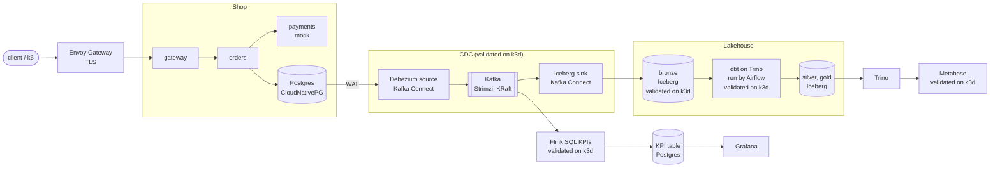
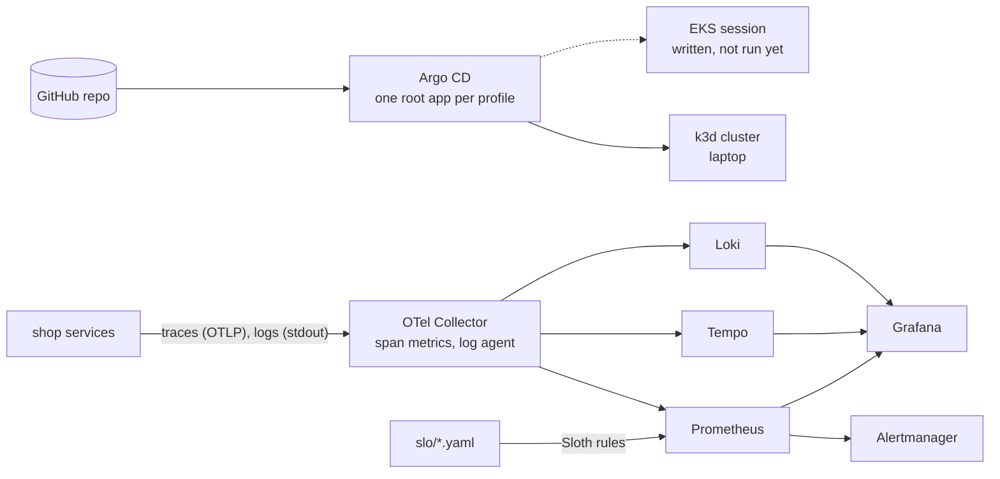

# shopflow

[](https://github.com/winthebest/shopflow/actions/workflows/ci.yml)
[](https://github.com/winthebest/shopflow/actions/workflows/platform-ci.yml)
[](https://github.com/winthebest/shopflow/actions/workflows/sre-ci.yml)
[](https://github.com/winthebest/shopflow/actions/workflows/data-ci.yml)
[](https://github.com/winthebest/shopflow/actions/workflows/infra-ci.yml)

A data platform built and operated end to end. A three-service shop writes orders to Postgres; Debezium streams
every change through Kafka into Apache Iceberg; dbt, Airflow and Trino turn the raw changes into analytics tables.
The stack is deployed by GitOps (Argo CD) on a local k3d cluster, watched by SLOs and alerts, and written to run
on short-lived AWS EKS sessions under a hard cost budget.

This is a portfolio project. Each claim below links to the measurement, test or decision record behind it. Work
that is not finished is marked *in progress* or *planned*.

**What it demonstrates**

- **DevOps:** GitOps with composable profiles, a Gateway API edge with TLS, encrypted secrets in Git, OpenTofu
  for AWS tested offline in CI, which has no AWS access at all.
- **SRE:** SLOs as code with multi-window burn-rate alerts, unit-tested detection times, one runbook per alert,
  load and soak tests, chaos game days and a restore drill, each written up with its numbers.
- **Data engineering:** log-based CDC into an Iceberg lakehouse, bronze → silver → gold with dbt, Airflow
  orchestration, data contracts checked in CI, CDC lag and gold freshness SLOs, and a BI dashboard provisioned
  from Git.

[Architecture](#architecture) · [Highlights](#highlights-with-evidence) · [Tech stack](#tech-stack) ·
[Quickstart](#quickstart) · [Repository map](#repository-map) · [Status](#status-and-roadmap) ·
[Design decisions](#design-decisions) · [Docs](#documentation)

## Architecture

**Data path.** Orders flow from the shop into Postgres, out through CDC, and into Iceberg tables that dbt
refines and Trino serves.



Iceberg data lives in SeaweedFS behind an Apache Polaris REST catalog (S3 and AWS Glue on AWS). CDC into
bronze, the Flink KPI job (profile `rt`), dbt + Airflow (profile `batch`) and Metabase (profile `bi`) are validated
end to end on a local k3d cluster, not yet on AWS.

**Platform and observability.** After the bootstrap, Git is the only deploy path. Every request is traced, and
the SLIs come from those traces.



## Highlights with evidence

| Claim | Evidence |
|---|---|
| Gate 2, run on 2026-10-10 from `main`: `make up` on a fresh k3d cluster (warm image caches) ready in 301 s (`core,obs`) and 314 s (`core,obs-lite,data`); k6 at 10 checkouts/s with 0 errors, p95 72–77 ms; CDC `c,u,d` into bronze in 34–68 s; NetworkPolicy probe 34/34; Tempo peak memory at 26% of its limit | [Gate 2 record](docs/gates/2026-10-10-gate-2.md) |
| Gate 3, run on 2026-10-14 for the local scope of Phases 5 and 7: PASS with open items; the SRE gate check had 13 passes and 0 failures (4 checks skipped by design), and a test order reached bronze as `c,u,d` in 36 s | [Gate 3 record](docs/gates/2026-10-14-gate-3.md) |
| Checkout p95 **72 ms** at 20 checkouts/s on docker compose; 0 HTTP errors; every acknowledged order found in Postgres, none left pending | [docs/perf-baseline.md](docs/perf-baseline.md) |
| Checkout SLOs as code: **99.5%** availability and **99% under 300 ms** over 28 days, with multi-window burn-rate pages and tickets | [docs/slo/checkout.md](docs/slo/checkout.md), [slo/checkout.yaml](slo/checkout.yaml) |
| Detection times proven by promtool unit tests: a page about 9 minutes after every checkout turns slow, no NaN when the lab is idle, a ticket when the SLI goes missing | [slo/tests/checkout.test.yaml](slo/tests/checkout.test.yaml) |
| Soak on k3d at 10 checkouts/s: a **97-minute** clean window with p99 ≈ 100 ms. No 2-hour window was clean (the laptop slept). Page timing on the cluster is moved to Phase 7 | [Measured results](docs/slo/checkout.md#measured-results) |
| A real incident during the soak: both SLO tickets fired, the first within a minute. The postmortem covers budget used, timeline and what failed (the alert reached nobody) | [Postmortem](docs/postmortems/2026-10-09-checkout-slow-noisy-neighbor.md) |
| SLIs come from span metrics in one OTel pipeline, so they kept counting while Tempo was crash-looping | [ADR 0301](docs/adr/0301-otel-collector-single-pipeline.md), [postmortem](docs/postmortems/2026-10-09-checkout-slow-noisy-neighbor.md#what-went-well) |
| GitOps fails closed: CI builds every profile and fails if any app would not follow the deployed Git revision | [gitops.md §4](docs/contracts/gitops.md#4-profiles), [platform-validate.sh](scripts/platform-validate.sh) |
| Security baseline: Pod Security `restricted` in the core namespaces (`baseline` for data and Airflow, `privileged` for observability), default-deny NetworkPolicies in all of them, SOPS-encrypted secrets, admin UIs only through port-forward, Kafka over TLS + SCRAM, gitleaks, images pinned by digest | ADRs [0208](docs/adr/0208-psa-and-network-policies.md), [0204](docs/adr/0204-sops-ksops-local-secrets.md), [0205](docs/adr/0205-admin-ui-port-forward-only.md), [0404](docs/adr/0404-kafka-tls-scram-acl.md) |
| CDC end to end on k3d (`core,obs-lite,data`): the snapshot put 100/100 customers in bronze; one order's insert, update and delete reached bronze as `c,u,d` in **47 s** (target ≤ 120 s); bronze heartbeat freshness 27 s; Debezium 3 ms behind the source when idle; ~10.6 GB RAM. Not run on AWS yet | [PR #122](https://github.com/winthebest/shopflow/pull/122), [data-cluster-check.sh](scripts/data-cluster-check.sh) |
| Realtime KPIs with Flink SQL on k3d (`core,obs-lite,data,rt`): under k6 at 10 checkouts/s, a minute's KPIs are in Postgres 34 s after its window closes (67 s after the load starts); per-minute order counts match the `orders` table exactly; the Grafana KPI panels show data; when orders stop, quiet minutes still close, written with 0 orders 38–42 s after they end (the CDC heartbeat keeps the watermark moving); with the CDC source stopped for 3 minutes and resumed, all 10 minutes of the run matched `orders` exactly, 0 late records dropped; ~12.6 GB RAM, so `rt` runs as an exclusive slot. Not run on AWS yet | [ADR 0415, Consequences](docs/adr/0415-flink-sql-realtime-kpis.md#consequences) |
| dbt and Airflow on k3d (`core,obs-lite,data,batch`): `dbt_build` ran 28/28 tasks on Trino, 5 min 42 s on empty schemas and 44–46 s for later runs; after 601 k6 checkouts, gold matches Postgres exactly (601 orders: 589 paid, 12 failed; paid revenue 52,844.70 on both sides); orders deleted in bronze are absent from silver and gold. Not run on AWS yet | [ADR 0414, Consequences](docs/adr/0414-airflow3-local-executor-cosmos.md#consequences) |
| Data checks on a 4-hour k3d slot: with `dbt_build` paused under traffic, the gold-freshness SLO paged about 99 minutes after the last refresh (unit-tested bound: 105); after a re-snapshot with 5 orders deleted while the connector was stopped, the reconciliation DAG passed 5/5 two-way checks, silver equals Postgres (26,409 orders), and the deleted orders are gone from silver and gold. The DAG-failure alert could not fire as deployed (no read grant on Airflow's `dag_run`): game day 4 found it, and the fix is live ([#269](https://github.com/winthebest/shopflow/pull/269)), though no failing run has fired the alert on it yet | [ADR 0414](docs/adr/0414-airflow3-local-executor-cosmos.md#consequences), [ADR 0406](docs/adr/0406-append-only-bronze-cdc-epoch.md#consequences), [gold freshness](docs/slo/gold-freshness.md#alerting) |
| Metabase on k3d (profile `bi`): the "Shopflow sales" dashboard is provisioned from Git through Metabase's API, and its three questions return rows from gold; as user `metabase`, Trino allows reads of gold and denies silver, the writable catalog, CREATE and INSERT; ~11.8 GB RAM, so `bi` does not share a slot with `batch`. Not run on AWS yet | [ADR 0416, Consequences](docs/adr/0416-metabase-bi-dashboards-from-git.md#consequences) |
| Event-driven fulfillment worker on k3d (profile `ops`): at 80 checkouts/s KEDA scaled it 1 → 3 replicas in 19 s (`lagThreshold` 50, since raised to 3,000 from these measurements); a full Debezium re-snapshot replayed 21,339/21,339 orders with 0 duplicate shipments; re-running `make up` keeps the CDC epoch | [Worker scaling](docs/perf-baseline.md#worker-scaling-under-load), [re-snapshot](docs/perf-baseline.md#idempotency-under-a-full-re-snapshot) |
| Game day 1, payments 800 ms slower for 15 minutes, run before and after the checkout resilience fix: the latency burn at the end of the fault fell from 100× to 1.7× and its page no longer fired; checkout p99 over the run fell from 825 ms to 108 ms; orders created and failed during the fault fell from 8,991 to 11, because the circuit breaker answers a fast 503 instead of a slow 504. Availability did not improve (200× burn and 16.1% failed checkouts in both runs): with every payments pod slow, no retry can succeed, and the partial-fault run that would show a difference has not been run | [GD1 postmortem](docs/postmortems/2026-10-14-gd1-payments-latency.md) |
| Game day 2, the Postgres primary killed under 10 checkouts/s, with and without logical slot sync: CloudNativePG promoted the replica in 20.6–20.7 s; no checkout succeeded for about 24 s (211–225 of ~25,190 failed) and no acknowledged order was lost. Without slot sync, Debezium found its slot gone and re-snapshotted, leaving a 4.07 s window in which writes would have been missed silently (it was empty by timing); with slot sync, Debezium resumed with no snapshot and the 54 orders written in that race all streamed. The gate check now verifies the slot on the standby ([#282](https://github.com/winthebest/shopflow/pull/282)) | [GD2 postmortem](docs/postmortems/2026-10-14-gd2-kill-postgres-primary.md) |
| Game day 3, Kafka Connect down for 30 minutes under 10 checkouts/s: checkout unaffected (0 failed of 114,001 requests, p99 88 ms); the CDC SLO paged at +8 min as planned; Debezium resumed from its offset in the same epoch, so no order was lost; the worker drained a 34,845-record backlog in 131 s with 0 duplicate shipments. The WAL alerts did not fire at the measured rate (lead time ~55 min, projected); a re-run with a lower cap fired them live (next row) | [GD3 postmortem](docs/postmortems/2026-10-10-gd3-debezium-stopped.md) |
| Game day 3 re-run with a lowered cap (game day 3b): Kafka Connect down for 22 minutes with the slot's WAL cap at 512 MB on an unmerged test branch (main keeps 2 GB), so the WAL alerts could fire live. `PostgresSlotWALRetainedCritical` paged at +18 min (56% of the cap), on its forecast of reaching the cap within an hour, and `PostgresSlotWALRetainedHigh` ticketed at +21 min; the slot peaked at 77.9% and was not invalidated; CDC resumed from its offset and nothing was lost; checkout kept working (13 timeouts in 16,271 checkouts, one of them during the CDC catch-up). The page came late because its forecast used a 30-minute window; fixed with a 15-minute window (page at +11 min instead of +17 min in a replay of the same run, [#225](https://github.com/winthebest/shopflow/pull/225)) | [Game day 3b postmortem](docs/postmortems/2026-10-12-gd3b-wal-alerts-live.md) |
| Game day 4, `orders.customer_id` renamed outside CI under 2 checkouts/s: checkout unaffected; the next hourly `dbt_build` failed its `not_null` test (6,479 orders), and `AirflowDagRunFailed` fired 65 minutes after the rename, but only thanks to a grant added by hand: as deployed, the alert could never fire. Both gaps are fixed (the grant, [#269](https://github.com/winthebest/shopflow/pull/269); an alert on failing exporter queries, [#267](https://github.com/winthebest/shopflow/pull/267)), and tests now show the contract gate rejects the rename ([#289](https://github.com/winthebest/shopflow/pull/289)). The restore took 1 s; gold was never rebuilt from the NULLs | [GD4 postmortem](docs/postmortems/2026-10-14-gd4-orders-customer-id-renamed.md) |
| A correctness bug found by load and fixed: at 80 checkouts/s (beyond one local orders replica), 94 orders were charged but left `pending` and 49 paid orders returned a 5xx. Fixed with an idempotent settle and no read after settle ([#192](https://github.com/winthebest/shopflow/pull/192)) and a sweeper that re-settles stranded orders ([#196](https://github.com/winthebest/shopflow/pull/196)), plus CPU autoscaling for gateway and orders with database pools sized to Postgres's connection budget ([#199](https://github.com/winthebest/shopflow/pull/199)). A retried checkout with the same `Idempotency-Key` no longer creates a second order or a second charge ([#213](https://github.com/winthebest/shopflow/pull/213)). Re-run on k3d: a deliberate fault (settles blocked for 20 s under load) stranded 401 orders, and the sweeper settled all of them within 70 s with their original charge (no second charge); across three runs (20–80 checkouts/s, 53,737 orders) retries with the same key created 0 duplicate orders, and the HPAs scaled orders and gateway up to 3 replicas. 80 checkouts/s was still not met on this laptop: a step load outran the autoscaling, client retries added to it, and at steady state the cluster hits the VM's CPU ceiling, a capacity limit rather than an application fault | [Checkout at 80/s](docs/perf-baseline.md#checkout-at-the-same-time-k6-through-the-gateway), [retry contract](docs/contracts/services.md#post-checkout-responses-gateway), [re-run](docs/perf-baseline.md#correctness-no-duplicate-order-no-duplicate-key-every-stranded-order-settled), [80/s on a laptop](docs/perf-baseline.md#80-checkoutss-not-met-on-this-laptop) |
| Restore drill on k3d (profile `drill`, backups in SeaweedFS), at 20 checkouts/s: 3 valid scripted drills destroyed shop-db and rebuilt it from its backup chain, twice to the latest point and once to a point in time; a checkout succeeds again 68–86 s after the disaster. RPO is bounded by `archive_timeout` (60 s), 44–46 s in the two valid latest-point runs. The runs found 5 bugs, all fixed, one of them new orders reusing the ids of acknowledged orders lost in the restore (the sequence now moves past the highest acknowledged id before traffic returns). In the same slot the WAL archive alert fired 11 min after the object store was blocked. Not run on AWS yet | [Restore results](docs/runbooks/restore.md#results), [PR #220](https://github.com/winthebest/shopflow/pull/220), [WAL archive alert](docs/runbooks/wal-archive.md) |
| Lab safety boundary (Phase 9, a Docker Compose stack on warehouses and buckets of its own): each zone is one Trino catalog, read-only in the engine for readers, with its own Polaris warehouse and principal and its own S3 key. For the read-only identity, if an engine rule were lost, Polaris would still refuse writes, snapshot expiry, rollback and optimize, and the key would still refuse removing orphan files. A deny-matrix test (3 identities × 4 catalogs × 15 operations, plus query isolation) passed 190 tests on a fresh stack | [ADR 0417](docs/adr/0417-catalog-scoped-safety-boundary.md), [deny matrix](lakeops/tests/test_deny_matrix.py) |
| AWS guardrails: a budget that excludes credits, a deny action at $25, and sessions bounded by a lease. Kill switches: an hourly sweep and a per-session schedule in AWS, plus `make cloud-reap` from the laptop. The account's $20/month spend limit is a hard stop that pauses the project, but near it AWS also denies the reaper's Lambda, so the laptop path (`make cloud-down`) is the guaranteed one. Cost *estimate* $0.45–0.51/h for the full stack (Sydney, on-demand), not yet measured | [docs/cost.md](docs/cost.md), [kill switches](docs/runbooks/cloud-session.md#kill-switches), ADRs [0510](docs/adr/0510-cost-guardrails-exclude-credits.md), [0501](docs/adr/0501-ephemeral-env-with-lease.md), [0513](docs/adr/0513-aws-project-account-constraints.md) |

## Tech stack

| Area | Tools | Decisions |
|---|---|---|
| Local platform | k3d, Argo CD (app-of-apps), Helm + Kustomize, Envoy Gateway (Gateway API), cert-manager, CloudNativePG, SOPS + age + KSOPS | [0200](docs/adr/0200-k3d-over-kind.md), [0201](docs/adr/0201-argocd-over-flux.md), [0202](docs/adr/0202-gateway-api-envoy-gateway.md), [0203](docs/adr/0203-cnpg-over-rds.md), [0204](docs/adr/0204-sops-ksops-local-secrets.md) |
| Cloud | OpenTofu, EKS on on-demand Graviton in Sydney (`ap-southeast-2`), no NAT gateway, External Secrets + SSM, images in GHCR | [0500](docs/adr/0500-opentofu-over-terraform.md), [0503](docs/adr/0503-no-nat-public-subnets.md), [0507](docs/adr/0507-ghcr-over-ecr.md), [0508](docs/adr/0508-ssm-over-secrets-manager.md), [0513](docs/adr/0513-aws-project-account-constraints.md) |
| CI | GitHub Actions per area: ruff, pytest + testcontainers, kubeconform, promtool, sqlfluff, `tofu test` with mocked providers, tflint, trivy, zizmor, shellcheck, gitleaks; no AWS access | [0513](docs/adr/0513-aws-project-account-constraints.md) |
| Observability, SLO | OpenTelemetry Collector, Prometheus + Alertmanager, Loki, Tempo, Grafana, Sloth, k6 | [0300](docs/adr/0300-slo-tooling-sloth.md), [0301](docs/adr/0301-otel-collector-single-pipeline.md), [0302](docs/adr/0302-observability-backends-chart-sources.md) |
| Ingest | Debezium, Kafka on Strimzi (KRaft), Iceberg sink connector | [0400](docs/adr/0400-kafka-kraft-debezium-iceberg-versions.md), [0403](docs/adr/0403-strimzi-over-msk.md), [0405](docs/adr/0405-json-converter-no-registry.md), [0406](docs/adr/0406-append-only-bronze-cdc-epoch.md) |
| Lakehouse | Apache Iceberg v2, Apache Polaris, SeaweedFS (AWS: S3 + Glue), Trino | [0407](docs/adr/0407-iceberg-format-v2.md), [0408](docs/adr/0408-iceberg-rest-catalog-polaris.md), [0409](docs/adr/0409-seaweedfs-over-minio.md), [0410](docs/adr/0410-trino-catalogs-per-identity.md), [0506](docs/adr/0506-glue-catalog-on-aws.md) |
| Transform, serve | dbt Core, Airflow 3 + Cosmos, custom freshness exporter, Flink SQL, Metabase | [0412](docs/adr/0412-dbt-core-over-sqlmesh.md), [0414](docs/adr/0414-airflow3-local-executor-cosmos.md), [0402](docs/adr/0402-freshness-exporter-custom.md), [0415](docs/adr/0415-flink-sql-realtime-kpis.md), [0416](docs/adr/0416-metabase-bi-dashboards-from-git.md) |
| Shop | Python 3.12, FastAPI, uv workspace, Alembic, data contracts checked in CI | [0100](docs/adr/0100-app-language-python-fastapi.md), [0101](docs/adr/0101-data-contracts-in-ci.md) |
| Lab | Docker Compose stack with Trino, Polaris and SeaweedFS on warehouses and buckets of its own; a pytest deny matrix | [0417](docs/adr/0417-catalog-scoped-safety-boundary.md), [0418](docs/adr/0418-iceberg-tags-short-lived-pins.md) |

## Quickstart

Requirements: Docker with Compose, GNU Make, and [k6](https://k6.io) for the load test. `make help` lists every
target.

**1. The shop on docker compose.** Runs on any machine with Docker; no secrets needed.

```bash
make dev                              # Postgres, migrations, seed data, gateway + orders + payments
curl -s http://localhost:8000/products
make app-loadtest                     # k6: 20 checkouts/s for 5 minutes; summary in out/
make dev-down                         # stop (make dev-reset also deletes the database volume)
```

**2. The platform on k3d.** Maintainer setup; prerequisites in
[docs/runbooks/local-platform.md](docs/runbooks/local-platform.md).

```bash
make up PROFILES=core,obs             # k3d cluster, Argo CD, one root app per profile
make status                           # nodes, Argo CD applications, routes, memory
make down                             # delete the cluster and its registry
```

Profiles combine: `core` (edge, Postgres, shop), `obs` or `obs-lite` (observability), `data` (needs one of the
two), `rt` (Flink), `batch` (Airflow), `bi` (Metabase) and `ops` (KEDA, fulfillment worker), all needing `data`, and
`drill` (backups for the restore drill; needs `core`, not combined with `data`). Rules:
[gitops.md §4](docs/contracts/gitops.md#4-profiles). `rt`, `batch` and `bi` each need about 12–13 GB with
`core,obs-lite,data`, so they run as exclusive slots on a 16 GB Docker VM; memory per profile:
[environment.md](docs/contracts/environment.md).

The k3d path decrypts SOPS secrets with the maintainer's age key
([ADR 0204](docs/adr/0204-sops-ksops-local-secrets.md)). A fork needs its own age recipient in `.sops.yaml` and
regenerated secrets; this is not scripted yet.

**3. AWS.** `make cloud-up` / `make cloud-down`. Not run yet; owner-only; *estimate* $0.45–0.51/h. See
[docs/cost.md](docs/cost.md) and [docs/runbooks/cloud-session.md](docs/runbooks/cloud-session.md).

## Repository map

| Path | Contents |
|---|---|
| [`services/`](services) | Shop services (gateway, orders, payments), fulfillment worker, shared library, freshness exporter |
| [`data/`](data) | Data contracts for CDC tables, dbt project, Airflow DAGs, Flink SQL job |
| [`deploy/`](deploy) | Argo CD apps and profiles (local and AWS), in-repo Helm charts, per-component values and manifests |
| [`infra/`](infra) | OpenTofu layers (bootstrap, network, cluster), Lambda reaper, cloud contract |
| [`slo/`](slo) | Sloth SLO specs, promtool tests, the 28-day window |
| [`chaos/`](chaos) | Game-day experiments, applied only during a game day |
| [`loadtest/`](loadtest) | k6 browse + checkout scenario |
| [`lab/`](lab), [`lakeops/`](lakeops) | Lab stack (Docker Compose) and its safety-boundary spikes; the deny-matrix tests |
| [`images/`](images) | Kafka Connect image (Debezium + Iceberg sink) built in CI |
| [`scripts/`](scripts), [`mk/`](mk) | Cluster, cloud, data and validation scripts; one make file per area |
| [`docs/`](docs) | Contracts, ADRs, SLOs, runbooks, postmortems, performance and cost |

## Status and roadmap

| Phase | Scope | Status |
|---|---|---|
| 1 | Shop services, compose, CI, performance baseline | Done |
| 2 | k3d + Argo CD, edge with TLS, CloudNativePG, SOPS, Pod Security, NetworkPolicies | Done (Gate 1 passed) |
| 3 | OpenTelemetry, Prometheus/Loki/Tempo, checkout SLOs, soak, postmortem | Done (Gate 2 passed); page timing on the cluster moved to Phase 7 |
| 4 | CDC: Debezium, Kafka, Iceberg, Polaris, Trino, CDC lag SLO | Done (Gate 2 passed, local k3d) |
| 5 | dbt bronze → silver → gold, Airflow, Flink KPIs, Metabase, data quality | Done locally ([Gate 3](docs/gates/2026-10-14-gate-3.md) passed): Flink KPIs, dbt + Airflow and Metabase validated on k3d; gold-freshness SLO measured; exact reconciliation after a re-snapshot with deleted orders. Open: a failing run firing the DAG-failure alert on its durable fix. Not run on AWS yet |
| 6 | AWS (Sydney): OpenTofu, EKS on on-demand Graviton, lease and reapers, cost guardrails, security baseline | In progress: offline checks pass in CI. The account type denies OIDC providers, so there is no GitHub → AWS access and `tofu plan` runs from the laptop. No AWS session run yet |
| 7 | Chaos game days, autoscaling, restore drills, page timing | Local part done ([Gate 3](docs/gates/2026-10-14-gate-3.md) passed): 4 of 4 local game-day scenarios, each with a postmortem (scenario 3 twice). Scenario 1 after the fix: latency burn 100× → 1.7×, checkout p99 825 → 108 ms, availability unchanged. KEDA, the HPAs, the stranded-order sweeper and `Idempotency-Key` checked on k3d; restore drill passed on k3d (RPO 44–46 s, service back in 68–86 s). Alerts fire, but no game day delivered a notification: the local webhook is a placeholder. Pending on EKS: scenarios 5–6 and the restore drills |
| 8 | Supply chain (signed images, SBOM, admission policy) and a short demo video | Planned |
| 9 | Lakehouse research lab: harness, catalog safety boundary, research workflow | In progress: lab stack and its safety boundary measured (3 independent layers for the read-only identity, 190-test deny matrix) |
| 10–14 | Lakehouse maintenance research (concurrent writers, compaction, retention), an LLMOps layer and a guarded lakehouse operator agent | Planned |

**How this was built.** The work follows a phased plan, split across parallel workstreams (app, platform, SRE,
data, cloud). Each owns its paths under written [contracts](docs/contracts/) and records its decisions as ADRs in
its own number range.

## Design decisions

Every non-obvious choice has a one-page ADR with the alternatives considered: [docs/adr/](docs/adr/README.md).
Seven that shape the system:

- [0201 Argo CD app-of-apps](docs/adr/0201-argocd-over-flux.md): one repo drives the laptop and EKS through
  overlays, and reviewers can see what is deployed, from which commit, and whether it is healthy.
- [0203 CloudNativePG, not RDS](docs/adr/0203-cnpg-over-rds.md): the same Postgres manifests on k3d and EKS,
  with logical replication for CDC and full control for restore drills.
- [0301 One OpenTelemetry pipeline](docs/adr/0301-otel-collector-single-pipeline.md): SLIs come from span
  metrics with a 300 ms bucket, so no service code changes are needed and SLOs survive without Tempo or Loki.
- [0406 Append-only bronze with a CDC epoch](docs/adr/0406-append-only-bronze-cdc-epoch.md): each Postgres
  "life" (new cluster, restore, re-snapshot) gets an epoch, so LSN ordering and sink commits stay correct.
- [0417 A lab safety boundary per Trino catalog](docs/adr/0417-catalog-scoped-safety-boundary.md): each zone
  gets its own catalog, warehouse, principal and storage key, so the read-only identity is held by three
  independent layers, each measured; a deny-matrix test fails if any outcome changes.
- [0501 Ephemeral AWS sessions with a lease](docs/adr/0501-ephemeral-env-with-lease.md): the main cost risk is
  a forgotten cluster; two independent reapers in AWS, an hourly sweep and a per-session schedule, delete it
  when the lease expires ([ADR 0513](docs/adr/0513-aws-project-account-constraints.md)).
- [0510 Cost guardrails that exclude credits](docs/adr/0510-cost-guardrails-exclude-credits.md): AWS applies
  credits before Budgets, so a default budget would stay at $0 and never alert.

## Documentation

| Doc | What it answers |
|---|---|
| [docs/contracts/](docs/contracts/) | Service API, path ownership, environment (clusters, ports, network flows), GitOps conventions |
| [docs/slo/](docs/slo/README.md) | Which SLOs exist, why these thresholds, error budget policy, measured results |
| [docs/runbooks/](docs/runbooks/) | What to do when an alert fires; how to run the local platform and a cloud session |
| [docs/postmortems/](docs/postmortems/) | Incidents and game days, their causes and action items |
| [docs/gates/](docs/gates/) | Phase gate records: what was checked, on which commit, and what is still open |
| [docs/perf-baseline.md](docs/perf-baseline.md) | Measured latency and resource use, with the commands to reproduce |
| [docs/cost.md](docs/cost.md) | AWS budget, guardrails and $/hour (estimated now, measured after the first sessions) |

## License

MIT; see [LICENSE](LICENSE). Built by [winthebest](https://github.com/winthebest).
